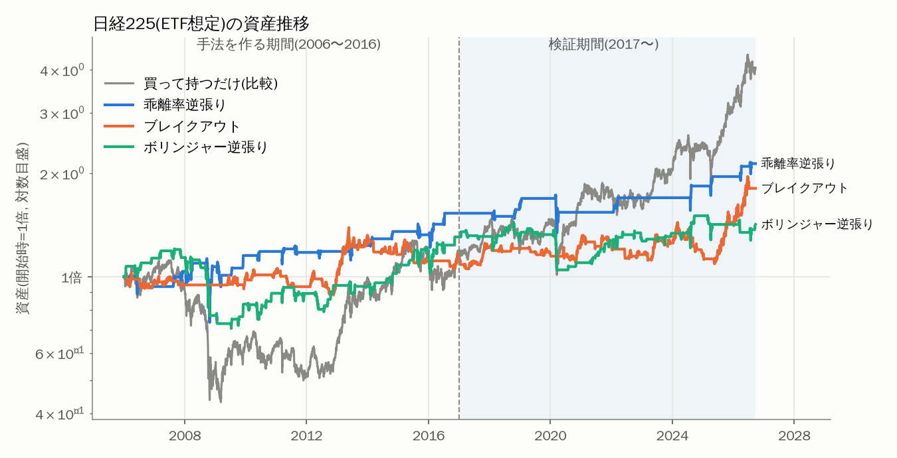
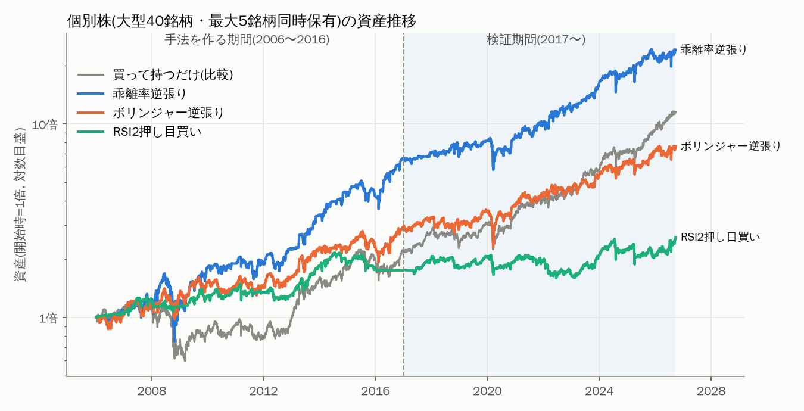
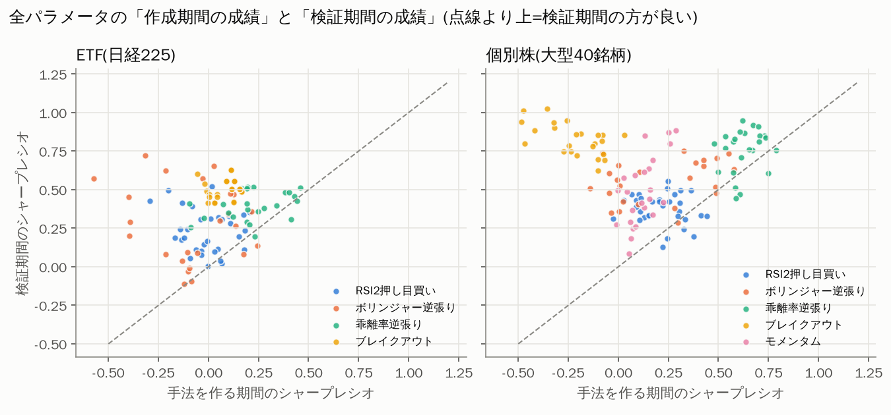
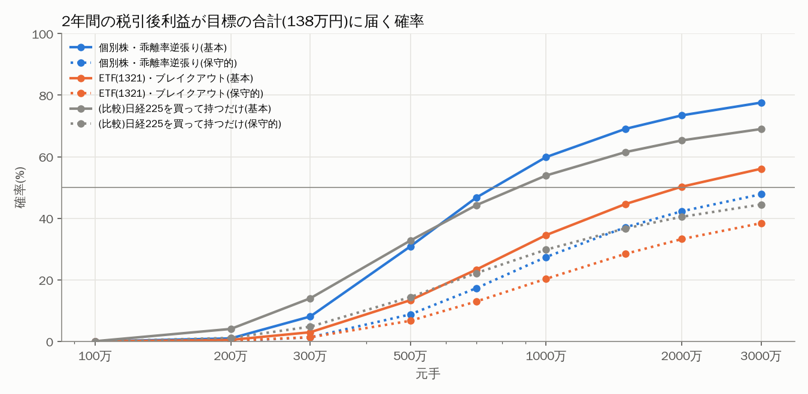

# スイングトレード手法 バックテスト検証レポート

作成日: 2026年9月25日　／　データ: Yahoo Finance 日足(〜2026年9月25日)

---

## 0. 結論（先に要点だけ）

1. **元手100〜300万円では、目標（最初の3か月は月1〜3万円 → 2年目後半は月10万円）に届く確率はほぼゼロ〜1割未満です。**
   検証で一番成績の良かった手法でも、利回りは「年10〜15%程度（税引前）」です。月10万円（税引後）を安定して得るには、**元手がおよそ1,000万円以上**必要という計算になります。
2. 作った5種類の手法のうち、**「作成期間」と「検証期間」の両方で安定して良かったのは、個別株の『乖離率逆張り』と『ボリンジャー逆張り』**でした（過剰最適化の兆候が小さい）。
3. ただし、検証期間（2017〜2026年）は日本株の強い上昇相場で、**「日経225を買って持つだけ」でも年13%**出ています。スイング手法が買い持ちに明確に勝ったのは、個別株の乖離率逆張りの「下落の小ささ」くらいで、**リターンの大きさでは買い持ちに勝てない手法がほとんど**でした。
4. どの手法でも、**約3か月に1回はマイナスの月**があり、**最大で資産の2〜3割が一時的に減る**ことを覚悟する必要があります。「毎月◯万円」という安定収入の形にはなりません。

> **現実的な提案**：目標金額を「毎月」ではなく「年単位」で考える、元手を本業収入から毎月積み増す、の2点を組み合わせるのが現実的です（詳しくは第7章）。

---

## 1. データ取得の確認

| データ元 | 結果 | 備考 |
|---|---|---|
| Yahoo Finance | ✅ 取得できた | 日足(始値・高値・安値・終値・出来高・配当/分割調整後終値) |
| stooq.com | ❌ 自動取得できない | サイト側がブラウザ認証（JavaScriptによるボット対策）を要求しており、プログラムからはCSVが返ってこない |

取得したデータ：
- **指数・ETF**：日経平均(^N225, 1970年〜)、1321 日経225連動型上場投信、1305 iFreeETF TOPIX、1330、1306（いずれもYahoo上は2009年〜）
- **個別株**：TOPIX Core30 を中心とした大型株40銘柄（ほとんど2000年〜）

データの品質チェックで、**1306(TOPIX連動型上場投信)は株式分割が未調整＋2026年3月末に異常値**があったため除外し、TOPIX ETFは同じTOPIX連動の **1305** を使いました。

---

## 2. 検証のしかた

### 2-1. 期間を分けて「過剰最適化」を防ぐ

過去データに合わせてパラメータ（数値設定）をいじり回すと、「過去にだけ当てはまる手法」ができてしまいます（過剰最適化）。これを防ぐために期間を分けました。

| 区分 | 期間 | 使い方 |
|---|---|---|
| **手法を作る期間**（インサンプル） | 2006年1月〜2016年12月（11年） | 各手法の数値設定を**この期間だけ**を見て決める。リーマンショック・アベノミクスを含む |
| **検証期間**（アウトオブサンプル） | 2017年1月〜2026年9月（約10年） | 決めた設定をそのまま当てはめ、**一度も見ていないデータ**で成績を確認。コロナショック・2024年8月の急落を含む |
| **ウォークフォワード**（追加の確認） | 2012年〜2026年 | 毎年「前年までのデータ」だけで設定を選び直し、翌1年運用する。実際の運用に一番近い方法 |

設定の選び方は「手法を作る期間の**シャープレシオ**（値動きの大きさの割にどれだけ儲かったか）が最大のもの」とし、取引回数が少なすぎる設定は除外しました。

### 2-2. 売買のルール（全手法共通）

- シグナルは**その日の終値で判定**し、**翌営業日の寄り付き（始値）で売買**（未来の情報を使わないため）
- 損切りは、ザラ場中に安値が損切り価格に届いたら約定。窓を開けて下で始まったら始値で約定
- **取引コストは片道0.1%**（手数料0円の証券会社でも、売り買いの気配値の差や約定のズレがあるため）
- 買いのみ（空売り・信用取引なし）、利益は再投資
- 個別株は**最大5銘柄まで同時保有**（資金を5等分）。ETFは1銘柄に全額

### 2-3. 用語の説明

| 用語 | 意味 |
|---|---|
| 勝率 | 利益が出た取引の割合 |
| **期待値/回** | 1回の取引あたりの平均損益（%）。**プラスでなければ、続けるほど負ける** |
| PF（プロフィットファクター） | 利益の合計 ÷ 損失の合計。1より大きければトータルでプラス。1.3以上なら良好 |
| 年率リターン | 1年あたり平均で資産が何%増えたか（複利） |
| **最大DD（ドローダウン）** | 資産がピークから最大で何%減ったか。**精神的・資金的に耐えられるかの目安** |
| シャープレシオ | リターン ÷ 値動きの大きさ。0.5で「まあまあ」、1.0で「かなり良い」 |

---

## 3. 作った手法（5種類）

| 手法 | タイプ | 考え方 | 作成期間で選ばれた設定（個別株） |
|---|---|---|---|
| **RSI2押し目買い** | 逆張り | 上昇トレンド中（終値＞200日線）に、2日RSIが極端に低い（短期の売られすぎ）ところを買い、5日線を上回ったら売る | RSI<10、最長10日保有 |
| **ボリンジャー逆張り** | 逆張り | 終値がボリンジャーバンドの−1.5σを下回ったら買い、20日線まで戻ったら売る | −1.5σ、損切り−5%、最長20日 |
| **乖離率逆張り** | 逆張り | 終値が25日線から−5%以上下に離れたら買い、25日線に戻ったら売る（日本の個人投資家におなじみの手法） | −5%、最長10日 |
| **ブレイクアウト** | 順張り | 20日間の高値を終値で更新したら買い、20日間の安値を割ったら売る | 20日高値/20日安値、損切り−8% |
| **モメンタム** | 順張り | 毎週金曜に、過去1年の上昇率が高い上位3銘柄を保有（保有は平均3か月程度で、スイングよりやや長め） | 過去250日、上位3銘柄 |

ETF（日経225）で選ばれた設定：RSI2押し目買い（RSI<5, 100日線）、ボリンジャー逆張り（−2σ, 損切り−5%）、乖離率逆張り（−7%, 損切り−8%）、ブレイクアウト（20日高値/10日安値, 200日線より上のときだけ）。

---

## 4. バックテスト結果

### 4-1. ETF（日経225・TOPIX）

作成期間は日経平均指数を1321等の日経225ETFの代わりとして使い（ETFのデータが2009年からしかないため）、検証期間は**実際のETF（1321, 1305）でも**確認しました。

| 対象 | 手法 | 期間 | 取引回数 | 勝率 | 期待値/回 | PF | 平均保有 | 年率リターン | 最大DD | シャープ |
|---|---|---|--:|--:|--:|--:|--:|--:|--:|--:|
| 日経225 | 買って持つだけ(比較) | 作成期間 | - | - | - | - | - | 1.4% | -61% | 0.18 |
| 日経225 | 買って持つだけ(比較) | 検証期間 | - | - | - | - | - | **13.4%** | -32% | **0.71** |
| 日経225 | RSI2押し目買い | 作成期間 | 26 | 69% | 0.45% | 1.96 | 4日 | 0.8% | -9% | 0.20 |
| 日経225 | RSI2押し目買い | 検証期間 | 35 | 71% | 0.49% | 1.86 | 3日 | 1.7% | -8% | 0.35 |
| 1321(実ETF) | RSI2押し目買い | 検証期間 | 34 | 68% | 0.21% | 1.32 | 3日 | 0.7% | -12% | 0.16 |
| 1305(実ETF) | RSI2押し目買い | 検証期間 | 31 | 71% | 0.27% | 1.53 | 3日 | 0.8% | -9% | 0.21 |
| 日経225 | ボリンジャー逆張り | 作成期間 | 66 | 59% | 0.53% | 1.25 | 8日 | 2.4% | -41% | 0.24 |
| 日経225 | ボリンジャー逆張り | 検証期間 | 56 | 62% | 0.26% | 1.15 | 7日 | 0.9% | -27% | 0.13 |
| 1321(実ETF) | ボリンジャー逆張り | 検証期間 | 51 | 65% | 0.49% | 1.30 | 7日 | 2.0% | -24% | 0.24 |
| 1305(実ETF) | ボリンジャー逆張り | 検証期間 | 50 | 74% | 0.67% | 1.49 | 7日 | 3.0% | -27% | 0.36 |
| 日経225 | 乖離率逆張り | 作成期間 | 30 | 63% | 1.73% | 1.66 | 11日 | 3.9% | -35% | 0.34 |
| 日経225 | 乖離率逆張り | 検証期間 | 13 | 69% | 2.86% | 2.40 | 10日 | 3.5% | -22% | 0.40 |
| 1321(実ETF) | 乖離率逆張り | 検証期間 | 13 | 69% | 2.82% | 2.12 | 10日 | 3.3% | -27% | 0.40 |
| 1305(実ETF) | 乖離率逆張り | 検証期間 | 10 | 70% | 3.04% | 2.18 | 9日 | 2.8% | -19% | 0.39 |
| 日経225 | ブレイクアウト | 作成期間 | 38 | 47% | 0.50% | 1.32 | 24日 | 1.2% | -25% | 0.17 |
| 日経225 | ブレイクアウト | 検証期間 | 41 | 39% | 1.36% | 1.87 | 24日 | 4.9% | -24% | 0.49 |
| 1321(実ETF) | ブレイクアウト | 検証期間 | 40 | 45% | 1.80% | 2.28 | 24日 | 6.6% | -17% | 0.63 |
| 1305(実ETF) | ブレイクアウト | 検証期間 | 45 | 44% | 0.46% | 1.33 | 24日 | 1.7% | -24% | 0.22 |

**読み取れること**
- どの手法も**期待値はプラス**（続ければトータルでは勝つ側）ですが、**取引のチャンスが年に数回しかない**ため、年率リターンは1〜7%と小さいです。資金の大半は現金で寝ています。
- **乖離率逆張り**は勝率約70%・PF2以上と「質」は高いものの、10年で10〜13回しか取引がありません。
- 買って持つだけ（年13%）には、リターンではどの手法も及びませんでした。一方で最大DDは多くの手法の方が小さく、「大きく負けにくい」という長所はあります。



### 4-2. 個別株（大型40銘柄、最大5銘柄同時保有）

| 手法 | 期間 | 取引回数 | 勝率 | 期待値/回 | PF | 平均保有 | 年率リターン | 最大DD | シャープ |
|---|---|--:|--:|--:|--:|--:|--:|--:|--:|
| 買って持つだけ(比較) | 作成期間 | - | - | - | - | - | 5.4% | -56% | 0.34 |
| 買って持つだけ(比較) | 検証期間 | - | - | - | - | - | **16.7%** | -26% | **0.92** |
| RSI2押し目買い | 作成期間 | 1136 | 65% | 0.28% | 1.24 | 4日 | 5.2% | -20% | 0.44 |
| RSI2押し目買い | 検証期間 | 1528 | 62% | 0.15% | 1.14 | 4日 | 4.1% | -26% | 0.33 |
| RSI2押し目買い | WF 2012〜 | 1884 | 60% | 0.08% | 1.06 | 4日 | 1.3% | -28% | 0.16 |
| ボリンジャー逆張り | 作成期間 | 1272 | 56% | 0.53% | 1.23 | 7日 | 10.2% | -31% | 0.58 |
| ボリンジャー逆張り | 検証期間 | 1140 | 58% | 0.49% | 1.23 | 8日 | 10.3% | -35% | 0.63 |
| ボリンジャー逆張り | WF 2012〜 | 1639 | 59% | 0.56% | 1.26 | 8日 | 11.0% | -35% | 0.67 |
| **乖離率逆張り** | 作成期間 | 875 | 59% | 1.24% | 1.56 | 9日 | 18.8% | -55% | 0.79 |
| **乖離率逆張り** | 検証期間 | 803 | 59% | **0.89%** | **1.47** | 10日 | **14.3%** | **-31%** | **0.76** |
| **乖離率逆張り** | WF 2012〜 | 783 | 57% | 0.86% | 1.37 | 10日 | 8.5% | -31% | 0.55 |
| ブレイクアウト | 作成期間 | 324 | 35% | 0.34% | 1.08 | 36日 | **-1.3%** | **-72%** | 0.03 |
| ブレイクアウト | 検証期間 | 225 | 44% | 3.72% | 2.18 | 48日 | 15.4% | -30% | 0.85 |
| モメンタム | 作成期間 | 130 | 49% | 3.88% | 1.67 | 94日 | 4.1% | -46% | 0.29 |
| モメンタム | 検証期間 | 90 | 56% | 12.03% | 4.09 | 102日 | 22.0% | -34% | 0.88 |

年別リターン（検証期間, %）

| 年 | 個別株・乖離率逆張り | 個別株・ボリンジャー逆張り | 個別株40銘柄 買い持ち | 1321・ブレイクアウト | 日経225 買い持ち |
|---|--:|--:|--:|--:|--:|
| 2017 | 6.3 | 11.5 | 27.0 | 8.2 | 19.1 |
| 2018 | 0.5 | -8.1 | -11.0 | -3.1 | -12.1 |
| 2019 | 15.6 | 18.4 | 30.4 | -1.8 | 18.2 |
| 2020 | 7.0 | 9.3 | 21.1 | 13.2 | 16.0 |
| 2021 | 14.4 | 13.2 | 14.5 | -0.7 | 4.9 |
| 2022 | 16.9 | 2.8 | -3.2 | -4.4 | -9.4 |
| 2023 | 37.0 | 19.8 | 33.5 | 3.6 | 28.2 |
| 2024 | 16.3 | 19.7 | 17.7 | 2.1 | 19.2 |
| 2025 | 19.7 | 12.0 | 19.1 | 23.8 | 26.2 |
| 2026(9月まで) | 8.2 | 6.4 | 23.4 | 28.9 | 31.8 |

**読み取れること**
- **乖離率逆張り**：作成期間・検証期間ともにシャープ0.8前後で安定。検証期間は10年間マイナスの年がなく、下げ相場の2018年・2022年もプラスでした。ただし作成期間には**−55%**（リーマンショック）の大きな下落があり、暴落時には逆張りは「落ちるナイフ」をつかむ点に注意が必要です。
- **ボリンジャー逆張り**：作成期間・検証期間・ウォークフォワードでほぼ同じ成績（年10〜11%）。一番「再現性が高い」手法です。
- **ブレイクアウト・モメンタム**（順張り）：作成期間は不調、検証期間だけ好調。**相場環境（上昇相場かどうか）に強く依存**しており、作成期間の情報だけでは選べない手法です。今後も同じように儲かるとは言えません。
- **RSI2押し目買い**：勝率は60%以上と高いのに、1回の利益が小さく、コストを引くとほとんど残りません。「勝率が高い＝儲かる」ではない典型例です。



---

## 5. 過剰最適化のチェック

下の図は、試したすべての設定（手法ごとに24〜48通り）について、「作成期間の成績」（横軸）と「検証期間の成績」（縦軸）を並べたものです。



- **乖離率逆張り（緑）**は、どの設定でも検証期間のシャープが0.4〜0.95とまとまっていて、**「たまたま当たった設定」ではなく手法そのものに一定の効果がある**と考えられます。
- 検証期間で全設定の中央値を取っても、乖離率逆張りは年11.7%・シャープ0.80、ボリンジャー逆張りは年7.3%・シャープ0.57で、選んだ設定の成績と大きく変わりません。
- **ブレイクアウト（黄）は右肩下がり**：作成期間で悪い設定ほど検証期間で良い、という逆の関係です。これは手法の実力というより相場環境の違いによるもので、信頼できません。

**取引コストにも敏感です**（個別株・検証期間の年率リターン）

| 片道コスト | 0% | 0.1%（基本） | 0.2% | 0.3% |
|---|--:|--:|--:|--:|
| 乖離率逆張り | 18.1% | 14.3% | 10.6% | 7.0% |
| ボリンジャー逆張り | 15.6% | 10.3% | 5.3% | 0.4% |

売買回数の多いボリンジャー逆張りは、コストが0.3%になるとほぼ利益が消えます。**約定の滑りを小さくすること（流動性の高い銘柄だけを扱う、成行を多用しない）が重要**です。

---

## 6. モンテカルロ・シミュレーション：「元手◯万円なら月◯万円に届く確率」

### 6-1. やり方
- 検証期間（2017〜2026年、116か月）の**実際の月次リターン**を、3か月単位でランダムに並べ替えて、**2年間（24か月）の資産推移を2万通り**作りました。
- 利益は再投資（複利）。1年ごとに利益へ**20.315%の税金**を引いています。目標は**税引後の月平均利益**で判定。
- 各フェーズ（1〜3か月目、4〜12か月目、13〜18か月目、19〜24か月目）の**平均月利益**が目標以上かどうかを数えました。
- 「保守的」シナリオは、月次リターンの平均を半分にしたもの。個別株の結果には生存者バイアス（第8章）があり、将来は過去ほど儲からない可能性が高いため、**こちらを実力の目安と考えるのが安全**です。

### 6-2. 結果：個別株・乖離率逆張り（最も成績の良かった手法）

**基本シナリオ（検証期間の実績どおり）**

| 元手 | 1〜3か月目 月1万以上 | 4〜12か月目 月3万以上 | 13〜18か月目 月8万以上 | 19〜24か月目 月10万以上 | **2年累計で目標合計138万以上** | 全フェーズ連続達成 | 2年後に元本割れ | 2年後資産(中央値) |
|--:|--:|--:|--:|--:|--:|--:|--:|--:|
| 100万円 | 45% | 4% | 0% | 0% | **0%** | 0% | 8% | 124万円 |
| 200万円 | 57% | 25% | 3% | 1% | **1%** | 0% | 8% | 248万円 |
| 300万円 | 61% | 41% | 9% | 6% | **8%** | 0% | 8% | 372万円 |
| 500万円 | 64% | 56% | 27% | 21% | **31%** | 3% | 8% | 619万円 |
| 700万円 | 65% | 62% | 40% | 35% | **47%** | 7% | 8% | 867万円 |
| 1000万円 | 66% | 66% | 50% | 46% | **60%** | 11% | 8% | 1239万円 |
| 1500万円 | 67% | 70% | 59% | 56% | **69%** | 16% | 8% | 1858万円 |
| 2000万円 | 68% | 71% | 62% | 60% | **73%** | 19% | 8% | 2478万円 |
| 3000万円 | 68% | 73% | 66% | 64% | **78%** | 22% | 8% | 3717万円 |

**保守的シナリオ（平均リターン半分）**

| 元手 | 1〜3か月目 月1万以上 | 4〜12か月目 月3万以上 | 13〜18か月目 月8万以上 | 19〜24か月目 月10万以上 | **2年累計で目標合計138万以上** | 全フェーズ連続達成 | 2年後に元本割れ | 2年後資産(中央値) |
|--:|--:|--:|--:|--:|--:|--:|--:|--:|
| 100万円 | 28% | 1% | 0% | 0% | **0%** | 0% | 26% | 110万円 |
| 300万円 | 50% | 21% | 4% | 2% | **1%** | 0% | 26% | 330万円 |
| 500万円 | 52% | 34% | 13% | 9% | **9%** | 0% | 26% | 550万円 |
| 1000万円 | 56% | 45% | 31% | 26% | **27%** | 2% | 26% | 1100万円 |
| 2000万円 | 56% | 51% | 43% | 41% | **42%** | 5% | 26% | 2200万円 |
| 3000万円 | 56% | 53% | 48% | 46% | **48%** | 7% | 26% | 3300万円 |



### 6-3. 目標達成に必要な元手（2年累計で目標合計138万円以上）

| 手法 | 確率50%で達成（基本） | 確率80%で達成（基本） | 確率50%で達成（保守的） |
|---|--:|--:|--:|
| 個別株・乖離率逆張り | **約760万円** | 約4,350万円 | 約3,740万円 |
| 個別株・2手法の組合せ（乖離率＋ボリンジャー半々） | 約870万円 | 約4,970万円 | 約4,410万円 |
| 個別株・ボリンジャー逆張り | 約1,230万円 | 1億円でも届かない | 1億円でも届かない |
| ETF(1321)・ブレイクアウト | 約1,960万円 | 1億円でも届かない | 1億円でも届かない |
| ETF(1321)・乖離率逆張り | 約3,330万円 | 1億円でも届かない | 1億円でも届かない |
| （比較）日経225を買って持つだけ | 約860万円 | 1億円でも届かない | 約9,270万円 |

### 6-4. ここから分かること
- **「毎月必ず◯万円」は、元手をいくら増やしても実現しません。** 全フェーズを連続で達成する確率は、3,000万円でも22%程度で頭打ちです。どの手法でも**3か月に1回程度はマイナスの月**があり、たまたま悪い時期に当たったフェーズは目標に届かないためです。
- 元手100〜300万円では、2年目の目標（月8〜10万円）はほぼ届きません。**税引前で月10万円（年120万円）を得るには、年率12%でも元手1,000万円が必要**という単純計算とも一致します（税引後で月10万円なら約1,250万円）。
- 「確率80%」のように確実性を求めると、必要な元手は一気に数千万円に増えます。
- 1000万円で運用した場合でも、**2年の間に資産が一時的に11%（中央値）、悪いケース（下位5%）では22%減る**ことを想定しておく必要があります。

---

## 7. 現実的な進め方の提案

1. **目標を「毎月」ではなく「年間」で考える**
   例：元手300万円・年10%なら年30万円（税引後24万円、月2万円相当）。これが過去データから見た現実的な水準です。
2. **本業収入から毎月積み立てて元手を増やす**
   今回の試算は「元手を追加しない」前提です。月5〜10万円を追加し続ければ、2〜3年で元手が数百万円増え、同じ利回りでも得られる金額は大きくなります（この条件での再試算も可能です）。
3. **まずは少額で「乖離率逆張り」や「ボリンジャー逆張り」を3〜6か月試す**
   バックテストと実際の成績（約定価格のずれ・心理面）の差を確認してから資金を増やしてください。
4. **目標のために信用取引（レバレッジ）を使うのはおすすめしません。** 元手を3倍に見せても、最大DD−30%が−90%になり、退場のリスクが急に高まります。
5. **NISAの成長投資枠はスイングトレード向きではありません。** 買うたびに年間枠（240万円）を消費し、売っても枠はその年には戻りません。また損失を他の利益と相殺できません。スイングは特定口座（源泉徴収あり）が無難です。

---

## 8. この検証の限界（必ずお読みください）

- **生存者バイアス**：個別株の40銘柄は「2026年時点の大型株」から選んでいます。2006年時点では、この中に後から大きく成長した銘柄が含まれる一方、途中で没落・上場廃止した銘柄は含まれていません。**個別株の結果は実際より良く見えている可能性が高い**です（ETFの結果にはこの問題はありません）。
- **売買単位（単元株）**：日本株は通常100株単位です。現在の株価で100株あたり、中央値で約47万円、キーエンス約800万円、ファーストリテイリング約690万円、東京エレクトロン約570万円です。**5銘柄に分散するには、少なくとも数百万円が必要**で、元手が少ない場合は安い銘柄に限定するか、単元未満株（S株・かぶミニ等。売買タイミングやコストに制約あり）を使うことになります。
- **検証期間の相場が良すぎた**：2017〜2026年は日本株が大きく上がった期間です。横ばい・下落が続く時期（例：2000年代後半）には、成績は大きく落ちる可能性があります。
- **コスト・約定**：片道0.1%で計算しています。成行注文が多い、流動性の低い銘柄を扱う、などでコストが増えると成績は大きく下がります（第5章）。
- **配当**：個別株・ETFは配当込み（調整後終値）で計算。日経平均指数での作成期間の計算には配当が含まれていません（保有期間が短いので影響は小さい）。
- **税金**：シミュレーションでは年単位で20.315%を差し引く簡易計算です。
- 過去の成績は将来の成績を保証しません。本レポートは投資判断の参考情報であり、特定の銘柄の売買を勧めるものではありません。

---

## 9. 再現方法

```bash
pip install -r requirements.txt
python src/fetch_data.py     # Yahoo Financeからデータ取得 → data/
python src/experiment.py     # 最適化・検証・ウォークフォワード → reports/results/
python src/montecarlo.py     # モンテカルロ → reports/results/mc_*.csv
python src/figures.py        # グラフ → reports/figures/
```

| ファイル | 内容 |
|---|---|
| `src/engine.py` | バックテストエンジン（売買ルール・成績指標） |
| `src/strategies.py` | 5つの手法とパラメータの探索範囲 |
| `reports/results/summary.csv` | 全手法の成績一覧 |
| `reports/results/grid.csv` | 全パラメータの作成期間/検証期間の成績 |
| `reports/results/wf_params.csv` | ウォークフォワードで毎年選ばれた設定 |
| `reports/results/trades_*.csv` | 全取引の明細 |
| `reports/results/mc_*.csv` | モンテカルロの詳細（全手法・全元手） |
